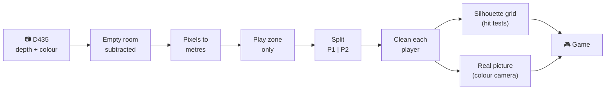

<div align="center">

# ⚡ Laser Duel

**Two players. One corridor. Lasers flying straight at you.**
*Jump, duck and dodge: the first to touch a laser loses.*


[Quick start](#-quick-start) •
[Controls](#-controls) •
[Settings](#%EF%B8%8F-settings-while-playing) •
[Camera setup](#-setting-up-the-camera-and-play-zone) •
[How the tracking works](#-how-the-tracking-works) •
[Tuning](#-tuning-and-troubleshooting)

</div>

---

## 🎮 The game

Two players stand side by side facing the projected screen, each in their
own lane. Lasers fly at them out of the depth of a 3D corridor:

| Laser | How to dodge |
| --- | --- |
| 🟥 **Low beam** | jump over it |
| 🟥 **High beam** | duck under it |
| 🎯 **Aimed beam** | step out of the way |
| ↗️ **Diagonal** | squeeze past where it is low enough or high enough |

The screen is a **mirror**: each player sees *themselves* (the real colour
camera image) inside their own glowing silhouette at the front of the
corridor, so they can see exactly where a laser will cross them. A thin line
on the players' plane shows where each laser is going to land.

> [!TIP]
> Every wave sends **the same laser down both lanes at the same moment**,
> and beam heights scale to each player's own height. A tall and a short
> player get an equally hard game.

---

## 🚀 Quick start

```bash
pip install -r laser_game/requirements.txt
```

```bash
python -m laser_game
```

| Command | What it does |
| --- | --- |
| `python -m laser_game` | 🎥 play with the RealSense D435 |
| `python -m laser_game --sim` | ⌨️ no camera: keyboard stick figures |
| `python -m laser_game --seed 7` | 🎲 same seed = same lasers |
| `python -m laser_game.zone_debug` | 🔍 see what the camera sees, tune the play zone |

**On start**

1. ⏳ **Step out** of the play area for 3 s. The camera captures the empty
   room *and* measures its own height and tilt from the floor (shown on
   screen for a few seconds).
2. 🧍🧍 When both players are in view for a second, a **3 s countdown**
   measures their heights.
3. ⚡ The round starts.

---

## 🕹 Controls

| Key | Action |
| --- | --- |
| <kbd>Enter</kbd> | Start now with whoever is in view (one player = solo) |
| <kbd>S</kbd> | ⚙️ Settings, while playing (<kbd>F1</kbd> with `--sim`) |
| <kbd>R</kbd> | Back to waiting for players |
| <kbd>B</kbd> | Re-capture the background and re-measure the camera (step out first) |
| <kbd>Tab</kbd> | Camera debug view |
| <kbd>F</kbd> | Fullscreen (projector) |
| <kbd>Esc</kbd> | Close the settings, or quit |

<details>
<summary><b>Keyboard mode (<code>--sim</code>)</b></summary>

| Key | Action |
| --- | --- |
| <kbd>A</kbd> <kbd>D</kbd> <kbd>W</kbd> <kbd>S</kbd> | Player 1: move, jump, duck |
| <kbd>←</kbd> <kbd>→</kbd> <kbd>↑</kbd> <kbd>↓</kbd> | Player 2: move, jump, duck |
| <kbd>1</kbd> / <kbd>2</kbd> | That player steps out of / back into view |
| <kbd>F1</kbd> | Settings |

</details>

---

## ⚙️ Settings while playing

Press <kbd>S</kbd>: the game keeps running behind the settings screen and
every change applies at once (lives: from the next round).

| Key | In the settings screen |
| --- | --- |
| <kbd>↑</kbd> <kbd>↓</kbd> | choose a setting |
| <kbd>←</kbd> <kbd>→</kbd> | change it (hold to repeat) |
| <kbd>Enter</kbd> | 💾 save to `laser_game/settings.json` |
| <kbd>D</kbd> | back to its `config.py` default |
| <kbd>S</kbd> / <kbd>Esc</kbd> | close |

| Group | Settings |
| --- | --- |
| **Play zone** | left / right edge, near / far, floor cut, top |
| **Tracking** | depth band around a player, edge trim, show real players |
| **Game** | lives, laser travel time (start, fastest), time between waves (start, fastest) |
| **Hits** | cells and frames that count as a hit, camera + projector delay |

> [!NOTE]
> **Where settings live:** `config.py` holds the defaults (every tunable
> number, with comments). `settings.json` is written by the settings screen
> (and by <kbd>w</kbd> in `zone_debug`) and **overrides** `config.py` at
> every start. A `*` in the settings screen marks a value that differs from
> `config.py`. Delete `settings.json` to go back to `config.py` entirely.

---

## 📐 Setting up the camera and play zone

```bash
python -m laser_game.zone_debug
```

Step out for the first 3 s. You get six live panels:

| Panel | Shows |
| --- | --- |
| **camera** | the colour camera, mirrored like the game |
| **depth** | near = bright, outside the zone dimmed. 🟥 movement outside the zone (ignored), 🟧 cut as an artifact, 🟦 Player 1, 🟩 Player 2 |
| **game** | exactly what the game gets: silhouettes with the real players inside |
| **above** | the room from above, 🟩 play zone, grey = what the depth camera sees, 🟨 what the colour camera sees |
| **side** | the room from the side: the floor must lie flat on the floor line |
| **info** | fps, tracking time, each player's distance, keys |

**Steps**

1. **Camera height and tilt** are measured from the floor automatically when
   the background is captured (at start, and on <kbd>b</kbd>). <kbd>f</kbd>
   measures again. In the *side* panel the floor must lie flat on the line.
   The camera needs to see some empty floor in the bottom part of its image.
2. **Play zone:** move the sliders until the green box in the *above* panel
   covers where the players stand and nothing else (walls, desks).
3. **Walk around:** in the *depth* panel you should be blue or green, with
   little orange around you.
4. <kbd>w</kbd> saves to `settings.json` (the game loads it), <kbd>p</kbd>
   prints the values to paste into `config.py`, <kbd>s</kbd> saves a
   snapshot picture.

> [!IMPORTANT]
> **Up close the camera can't see all of you.** The colour camera sees less
> than the depth camera (about 69°×42° against 89°×59°). Where only the
> depth camera sees you, the game draws your glowing silhouette without the
> real picture. With the camera about 1 m high looking straight ahead,
> feet are only visible from about 2.2 m away (depth) and 3.5 m (colour):
> the *above* and *side* panels show this. Stand further back, or mount the
> camera higher or further away.

---

## 🧠 How the tracking works



> **In one sentence:** the depth camera measures how far away every pixel
> is; we subtract the empty room to find people, turn their pixels into
> metres, keep only the play zone, split them into left and right player,
> clean up the edges, and draw each one as a silhouette (for the hit tests)
> with the colour image fitted inside it. 30 times a second.

### 1. The camera measures distance

The **Intel RealSense D435** has two infrared cameras a few centimetres
apart and a projector that throws an invisible dot pattern into the room.
By comparing the two infrared images (**stereo vision**, like our two eyes)
it calculates how far away every pixel is. The result is a **depth image**:
a picture where each pixel is a distance in millimetres instead of a colour.
We use it at 424×240 pixels, 30 frames per second.

### 2. Learning the empty room

At start everyone steps out, and the game records the depth of the empty
room, averaged over 45 frames. This is the **background**: walls,
furniture and plants at all their different distances.

From the floor in that same picture the game **calibrates the camera**: it
finds the flat plane that most points in the bottom of the image lie on
(*RANSAC* plane fitting), and from that plane works out how high the camera
is and how far it is tilted. So the camera can sit a little differently
every day and still work.

### 3. Finding people: background subtraction

In every new frame, a pixel that is **clearly closer than the empty room**
was there is something new, a person. "Clearly" means at least 8 cm closer,
or more far from the camera, where the depth measurement gets noisier. The
background keeps slowly re-learning where nobody stands (a moved chair,
changing light).

### 4. From pixels to metres

Using the camera's lens properties (focal length, image centre) and its
measured height and tilt, every pixel becomes a **real position in the
room**: how far to the side, how high above the floor, and how far away.

### 5. Only the play zone

Everything outside a box in the room is ignored: walls, desks, people
watching, the floor itself, and the noisy edge of the camera's range.

### 6. Splitting the two players

The game looks for the **emptiest vertical column** of pixels between the
players: everything left of it is Player 1, everything right is Player 2.
That divider is smoothed so it doesn't jump around, prefers the middle of
the image when several columns are equally empty, and each side keeps only
its largest blob.

### 7. Cleaning each player

- Pixels much **nearer or farther** than the player's own distance are
  dropped: smeared edge pixels, the floor at their feet, a chair touching
  them.
- The outline is **shaved by 1 pixel**: the camera makes near objects look
  slightly too big at their edges.

### 8. The silhouette on a grid

Each player is projected onto a **flat plane at their own distance** and
drawn on a grid of **3 cm squares**: x across the room, height above the
floor. A pixel with a slightly wrong depth then still lands right next to
the body instead of streaking outward. This grid is what the lasers are
tested against.

### 9. The real player inside

The colour camera's image is mapped onto the same plane in one step (a
**homography**, a 2D perspective transform) and cut out by the silhouette.
That is why the real image fits exactly inside the glow. Where the colour
camera can't see (it sees less than the depth camera), the picture fades
out and only the glow remains.

<details>
<summary><b>And then the game: how a hit is decided</b></summary>

- **Forgiving hits.** A laser counts only if it overlaps at least
  `MIN_HIT_CELLS` squares of your silhouette in `HIT_FRAMES` camera frames
  within `HIT_WINDOW_S` of reaching you, shifted by `DISPLAY_LAG_S` for the
  camera and projector delay (so it judges what you did when you *saw* the
  laser arrive).
- **Fair waves.** Beam heights are fractions of each player's own height
  (measured in the countdown), and aimed beams aim at each player.
- **Leaving doesn't save you.** Out of view for `FORFEIT_S` during a round
  counts as out.
- **Fake 3D.** The corridor and the lasers are perspective maths on 2D
  pygame lines: everything that glows is drawn on one black layer that is
  added onto the screen, so overlapping light adds up like real light.

</details>

---

## 🔧 Tuning and troubleshooting

| Problem | Try |
| --- | --- |
| Artifacts around the players | lower `PLAYER_DEPTH_BAND_M`, raise `EDGE_TRIM_PX`, tighten the `ZONE_*` box |
| Players cut off up close | see the *Up close* note above: stand further back or move the camera |
| "No floor found" at start | tilt the camera down a little so it sees floor, or set the fallback `CAMERA_HEIGHT_M` / `CAMERA_PITCH_DEG` |
| Silhouettes float above / sink below the floor | the camera calibration is off: check the *side* panel in `zone_debug`, press <kbd>f</kbd> |
| The split between players wanders | <kbd>Tab</kbd>: both should be tinted in their own colour; stand a bit further apart |
| Lanes don't match where people stand | `LANE_SPLIT_X_M` (0 = straight ahead of the camera) |
| Hits too strict or too easy | `MIN_HIT_CELLS`, `HIT_FRAMES`, `HIT_WINDOW_S`, `LASER_HIT_THICKNESS_M` |
| Too hard or too easy | `TRAVEL_*`, `SPAWN_GAP_*`, `LOW_BEAM`, `HIGH_BEAM`, `LIVES` |
| No real player picture | `SHOW_REAL_PLAYER = True` (the colour camera only starts when it is on at start) |

The measured heights in the player panels should match the players' real
heights: a quick check that the camera calibration is right.

---

## 📁 Project structure

The laser game is **self-contained**: everything it runs is inside
`laser_game/`, nothing is imported from `coop_game/`.

```
laser_game/
├── __main__.py        python -m laser_game
├── config.py          every tunable number, with comments (the defaults)
├── settings.py        the settings screen's list, settings.json
├── settings.json      saved settings, overrides config.py
├── game.py            pygame loop, HUD and settings screen
├── duel.py            rounds, waves, hit tests
├── lasers.py          laser shapes and waves
├── render.py          fake-3D drawing, real players inside the glow
├── sources.py         silhouettes from the camera or the keyboard
├── zone_debug.py      python -m laser_game.zone_debug
├── requirements.txt
└── vision/            depth camera -> each player's silhouette
    ├── camera.py      RealSense D435 depth + colour streams
    ├── background.py  empty-room depth model
    ├── floor.py       camera height + tilt measured from the floor
    ├── zone.py        the play zone box
    ├── players.py     split into Player 1 / 2, clean each one
    ├── geometry.py    pixels -> metres
    ├── bodies.py      silhouette grid + real-player picture
    └── tracker.py     camera thread: all of the above, 30 times a second
```
